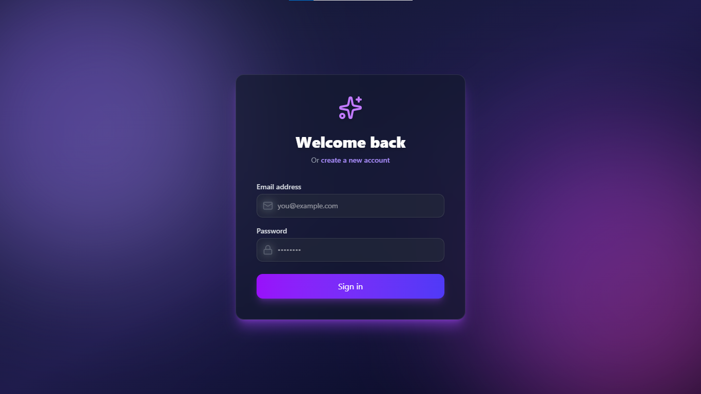
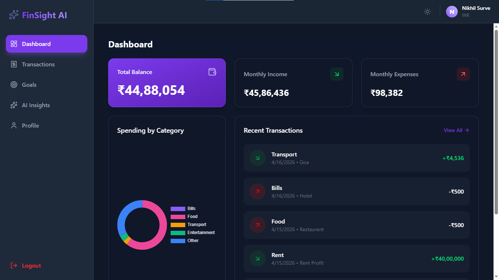
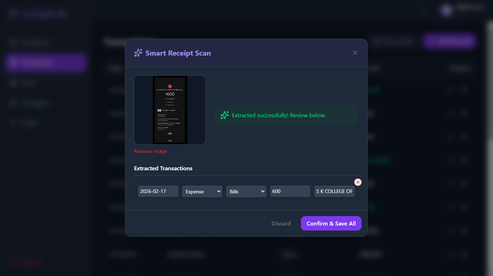
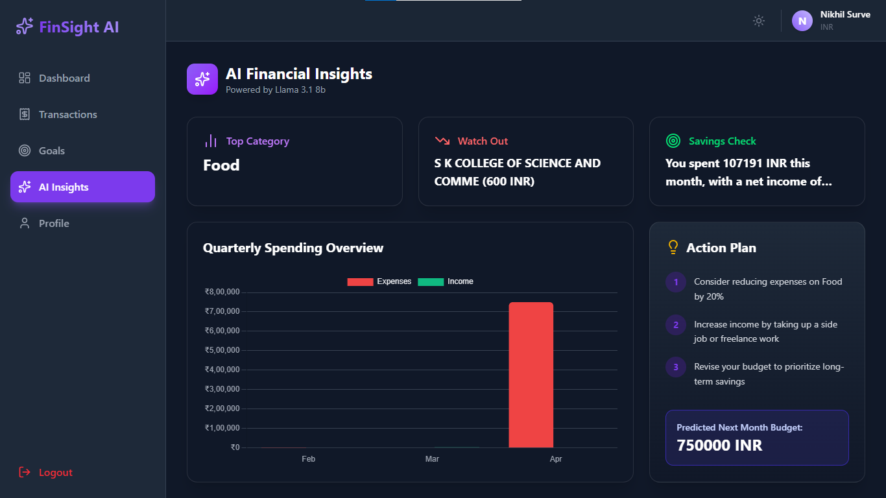
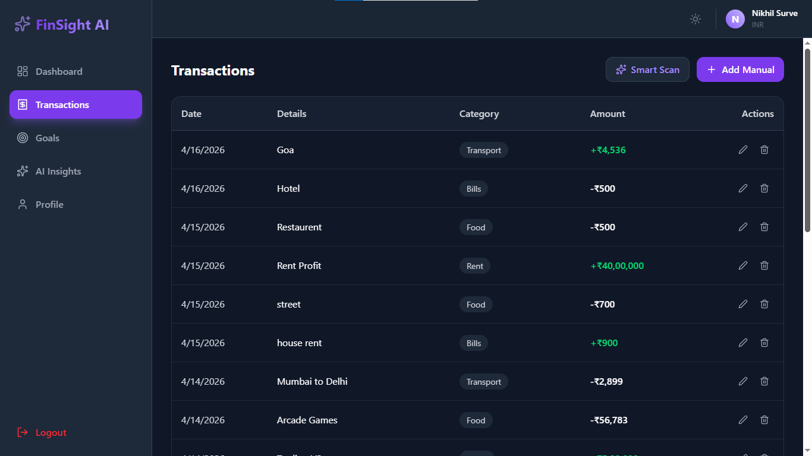
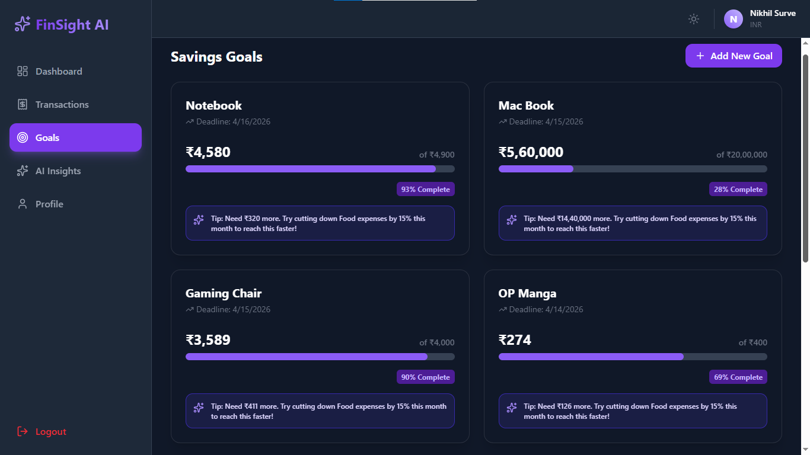

# 🚀 FinSight AI - Smart Personal Finance Tracker

<div align="center">

[](https://opensource.org/licenses/MIT)
[](https://nodejs.org/)
[](https://react.dev/)
[](https://tailwindcss.com/)
[](https://openrouter.ai/)

**A personal finance tracker concept with dashboards, goals, receipt scanning, and AI-assisted insights.**

[Explore Features](#-key-features) • [Installation](#-installation-guide) • [Tech Stack](#-tech-stack) • [Project Structure](#-project-structure)

</div>

---

## 📸 Screenshots

| Login (Dark Mode) | Dashboard Overview |
| :---: | :---: |
|  |  |

| Smart Receipt Scan | AI Insights |
| :---: | :---: |
|  |  |

| Transactions | Goals Tracking |
| :---: | :---: |
|  |  |

> [!TIP]
> **Mobile ready:** The project includes responsive UI layouts. See [Mobile View](assets/screenshots/mobile-view.png).

---

## ✨ Key Features

- **💳 Receipt scanning:** Upload a receipt or payment screenshot for AI-assisted extraction of merchant, date, amount, and category.
- **📊 Interactive dashboard:** Review income and expenses with charts.
- **🤖 AI-assisted insights:** Generate spending summaries and suggestions from transaction data.
- **🎯 Goals management:** Set savings goals and view progress.
- **💱 Currency options:** UI support for INR, USD, and GBP. Verify exchange-rate configuration before relying on converted values.
- **🌓 Modern interface:** React, Tailwind CSS, dark mode, and responsive layouts.
- **🔒 Authentication:** JWT-based authentication is part of the application architecture.

> **Important:** FinSight AI is a learning project, not a bank or a regulated financial service. AI-generated insights and calculations may be inaccurate and are not financial, tax, or investment advice. Do not use it as the sole basis for financial decisions.

---

## 🛠️ Tech Stack

### Frontend
- **Framework:** React 19 + Vite
- **Styling:** Tailwind CSS 4
- **State/Routing:** React Router 7, Context API
- **Charts:** Chart.js + React-Chartjs-2
- **Icons:** Lucide React

### Backend
- **Runtime:** Node.js
- **Framework:** Express.js 5
- **Database:** MongoDB with Mongoose
- **File uploads:** Multer
- **Authentication:** JSON Web Tokens (JWT) + bcrypt

### AI Infrastructure
- **Provider:** OpenRouter API
- **Vision/receipt parsing and text insights:** Model names are configured in the source. Confirm provider and model availability before deployment.

---

## 📂 Project Structure

```text
finsight-ai/
├── client/                 # Frontend (React + Vite)
│   ├── src/
│   │   ├── components/     # Reusable UI components
│   │   ├── context/        # Auth & Theme context
│   │   ├── pages/          # Page-level components
│   │   ├── utils/          # API helpers & formatters
│   │   └── App.jsx
│   └── tailwind.config.js
├── server/                 # Backend (Node.js + Express)
│   ├── controllers/        # Request handlers
│   ├── middleware/         # Auth & Error handling
│   ├── models/             # Mongoose schemas
│   ├── routes/             # API endpoints
│   ├── utils/              # AI and helper modules
│   └── server.js
├── assets/
│   └── screenshots/        # Project screenshots
├── .gitignore
└── README.md
```

---

## 🚀 Installation Guide

### Prerequisites
- [Node.js](https://nodejs.org/) (v18 or newer; use a version supported by the installed Vite version)
- [MongoDB](https://www.mongodb.com/) (local instance or Atlas)
- [OpenRouter API key](https://openrouter.ai/)

### 1. Clone the repository

```bash
git clone https://github.com/nikkk-surve/finsight-ai.git
cd finsight-ai
```

### 2. Configure the server

```bash
cd server
npm install
```

Create a `.env` file in the `server` directory using `.env.example` as a reference:

```env
PORT=5000
NODE_ENV=development
MONGODB_URI=your_mongodb_connection_string
JWT_SECRET=replace_with_a_long_random_secret
OPENROUTER_API_KEY=your_openrouter_api_key
VITE_API_URL=http://localhost:5000/api
```

Never commit a real `.env` file, API key, database URI, or production secret.

### 3. Install client dependencies

Open a second terminal from the repository root:

```bash
cd client
npm install
```

### 4. Run the application

In the `server` directory:

```bash
npm run dev
```

In the `client` directory, start a second terminal and run:

```bash
npm run dev
```

Use the local URL printed by Vite. Check the server's configured CORS origin and client API base URL if the browser cannot reach the backend.

---

## 🌐 Deployment

### Backend
- Deploy the server to a Node.js host.
- Configure environment variables in the hosting provider's dashboard.
- Use a secured MongoDB deployment and a strong, unique JWT secret.

### Frontend
- Build with `npm run build` from `client/`.
- Configure the client API URL to point to the deployed backend.
- Keep private API keys on the server. Any variable prefixed with `VITE_` is exposed to browser code and must not contain secrets.

---

## 🤝 Contributing

Contributions, bug reports, and documentation improvements are welcome. Start with [CONTRIBUTING.md](CONTRIBUTING.md).

## 📄 License

Distributed under the MIT License. See [LICENSE](LICENSE) for details.

## 👤 Author

Developed by [Nikhil Surve](https://github.com/nikkk-surve).

---

<div align="center">
  <sub>Built as a learning project with the MERN stack and OpenRouter AI.</sub>
</div>
